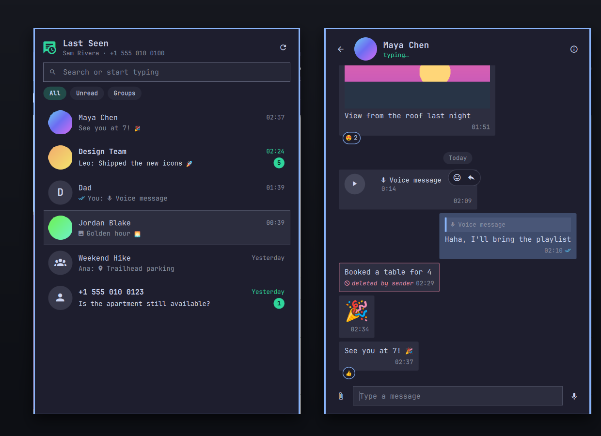

<p align="center">
  
</p>

<h1 align="center">Last Seen</h1>

<p align="center">
  <b>Your WhatsApp chats in the Omarchy bar. Fast, light, self-hosted.</b><br>
  Read, reply, react, send voice notes and files, without a browser tab or an Electron app.
</p>

<p align="center">
  <a href="LICENSE"></a>
  
  <a href="https://github.com/EvolutionAPI/evolution-api"></a>
  <a href="https://github.com/meliani/omarchy-lastseen/actions"></a>
</p>

<p align="center">
  
</p>

> Last Seen is an independent project. It is not affiliated with, endorsed by or sponsored by WhatsApp or Meta.
> "WhatsApp" is a trademark of WhatsApp LLC, used here only to say what the plugin works with.

---

## Why

WhatsApp on a Linux desktop usually means a browser tab or an Electron wrapper: hundreds of megabytes of RAM and a full web app running all day, just to see who wrote.

Last Seen runs WhatsApp **on your server**, not on your laptop:

- **[Evolution API](https://github.com/EvolutionAPI/evolution-api)**, on your own server, holds the WhatsApp session (as a linked device, like WhatsApp Web).
- Your desktop runs **one small Python process per account (about 45 MB, under 2% CPU)** and a native QML panel inside the Omarchy shell you already have.
- New messages arrive **instantly over RabbitMQ**. Without it, Last Seen polls quietly.

> **Last Seen depends on Evolution API.** You need an Evolution API server (2.3.x) with your phone linked to it.
> The [`server/`](server/) folder installs one with a single command.

## Features

**Chats**
- Chat list with pictures, unread counts, delivery ticks and "typing…"
- Search by name or number, filters (All / Unread / Groups); type a number to start a new chat
- Several WhatsApp accounts, switch with one click; unread counts and notifications per account
- Desktop notifications grouped per chat ("Alex (3)"); "Open" jumps to the chat; @mentions always notify

**Messages**
- Text with clickable links, quoted replies, reactions, edit (15 min) and delete for everyone
- Photos, videos, stickers, documents, voice notes, locations, contacts and polls shown inline
- Messages deleted by the sender stay readable, marked "deleted by sender"
- Photos, voice notes and files are saved as they arrive, so they survive deletion (3 GB cap, oldest dropped)
- Send files (picker) or paste an image with Ctrl+V, with a caption
- **Voice notes**: record, cancel or send; loudness evened out so a quiet mic still sounds right
- Drafts kept per chat; ↑ in an empty box edits your last message; big emoji-only messages

**People**
- Contact and group profiles: picture, number, About, members with admin badges, invite link
- Names for contacts WhatsApp hides the number of; merge two addresses of the same person
- Online / typing… / recording… / last seen (opt-in, see Privacy)
- Mark as unread, block, leave group

**Everything else**
- Keyboard first: arrows, Enter, Esc, type to search
- English and French (more welcome)
- Follows your Omarchy theme
- Demo mode with fake chats: try it with no server at all

## How it works

```
 your phone ──► WhatsApp ──► Evolution API ──► RabbitMQ ───────────────┐
                              (your server)       (optional, instant)  │
                                   ▲                                   ▼
                                   └──── REST (HTTPS) ──── Last Seen backend ──► Omarchy bar
                                                             (one per account)
```

The backend (`backend.py`) talks to Evolution API over REST, listens to RabbitMQ for new events, caches names, pictures and media, and streams JSON lines to the QML panel. Nothing runs in a browser and nothing calls third-party services.

## Install

### 1. Run Evolution API

On any machine with Docker (a small VPS, a home server or this laptop):

```bash
git clone https://github.com/meliani/omarchy-lastseen
cd omarchy-lastseen/server
./install.sh "My phone"
```

It generates the secrets, starts **Evolution API 2.3.7 + Postgres + Redis + RabbitMQ**, creates the account and shows a QR code. On your phone: **WhatsApp → Settings → Linked devices → Link a device**, then scan it. The installer prints the values the desktop setup asks for.

**HTTPS on a public server**: point a domain at the server, then in `server/.env` set `EVOLUTION_DOMAIN=chat.example.com` and `SERVER_URL=https://chat.example.com`, and run `./install.sh` again. Caddy gets the certificate automatically.

**Instant updates**: RabbitMQ listens on `127.0.0.1` by default. To reach it from your laptop, use a private network (Tailscale, WireGuard, your LAN) and set `AMQP_BIND` to that address. Skip this step and Last Seen polls every few seconds instead.

<details>
<summary>Already have an Evolution API server?</summary>

Last Seen works with Evolution API **2.3.x**. Version 2.4 requires activating every server against a licence service before its API answers, so the kit pins 2.3.7.

- REST: the desktop needs the server URL and each instance's **token** (not the global API key).
- Push (optional): enable RabbitMQ in global mode and these events:

  ```env
  RABBITMQ_ENABLED=true
  RABBITMQ_GLOBAL_ENABLED=true
  RABBITMQ_EXCHANGE_NAME=evolution
  RABBITMQ_EVENTS_MESSAGES_UPSERT=true
  RABBITMQ_EVENTS_MESSAGES_UPDATE=true
  RABBITMQ_EVENTS_CONNECTION_UPDATE=true
  RABBITMQ_EVENTS_PRESENCE_UPDATE=true
  ```

  and give the desktop its own RabbitMQ user that can only use its own queues:

  ```bash
  rabbitmqctl add_user lastseen '<password>'
  rabbitmqctl set_permissions -p / lastseen '^lastseen\..*' '^(lastseen\..*|evolution)$' '^(lastseen\..*|evolution)$'
  ```

  Another exchange name? Set it in the plugin's `amqpExchange` setting.
</details>

### 2. Add the plugin

```bash
omarchy plugin add https://github.com/meliani/omarchy-lastseen --enable
```

### 3. Connect it

```bash
~/.config/omarchy/plugins/meliani.lastseen/scripts/setup.sh
```

It asks for the server URL, your account name and its token, checks them, stores the secrets **in your keyring** (never in a file), installs what's missing (`libnotify`, `wl-clipboard`, `mpv`, `ffmpeg`, `python-pika`) and turns the account on. Click the icon in your bar.

**Just looking?** No server needed:

```bash
omarchy bar set meliani.lastseen accounts demo
```

## Settings

`omarchy bar set meliani.lastseen <key> <value>`, or the widget's settings in Omarchy:

| Key | Default | What it does |
| --- | --- | --- |
| `accounts` | (empty) | Evolution instance names, comma-separated. `demo` shows fake chats. |
| `countryCode` | (empty) | Your calling code (`33`, `212`…) so local numbers like `06…` work in search and new chats. |
| `amqpExchange` | `evolution` | Evolution's `RABBITMQ_EXCHANGE_NAME`, if you changed it. |
| `notifications` | `true` | Desktop notifications for new messages. |
| `notifyGroups` | `false` | Also for group messages (mentions of you always notify). |
| `autoDownload` | `true` | Save photos, voice notes and files as they arrive. |
| `appearOnline` | `false` | Appear online while a chat is open. WhatsApp shows others' online / typing only to clients that are online themselves. |

## Keyboard

| Key | In the list | In a chat |
| --- | --- | --- |
| Type | search | write |
| ↑ ↓ | move | ↑ on an empty box edits your last message |
| Enter | open the chat (or start one with a typed number) | send |
| Ctrl+V | | paste an image to send |
| Esc | clear search, close | cancel reply / edit / recording, back to the list |

## Privacy and security

- **Your messages stay between your phone, your server and your laptop.** Last Seen calls no other service.
- **Secrets live in your desktop keyring** (`secret-tool`, service `lastseen`): the server URL, each account's token and the optional RabbitMQ URI. `scripts/setup.sh --remove` forgets them all.
- **The desktop gets a least-privilege RabbitMQ user**: it may only create and read its own `lastseen.*` queues.
- **You appear offline by default.** Last Seen never sends "online", "typing…" or "recording…" unless you turn `appearOnline` on.
- **View-once media is not shown.** WhatsApp removes it before it reaches linked devices, and Last Seen won't work around a protection the sender chose. Open those on your phone.
- **Kept locally**: a name directory (`~/.local/state/lastseen`) and saved media and pictures (`~/.cache/lastseen`, 3 GB cap). Delete those folders to wipe them.
- Omarchy plugins run unsandboxed in your shell. Read the code (about 5,000 lines of QML and Python); every message string is shown as plain text (links go through a strict escaper).

## Known limits

- **Hidden numbers**: WhatsApp now addresses some people by a private ID (`@lid`) instead of their number. Evolution 2.3 can't always resolve it. Last Seen learns numbers as messages arrive, matches profile pictures, and lets you name or link the contact yourself.
- **Evolution API 2.4** needs licence activation, so stay on 2.3.x for now.
- Built for Omarchy (Hyprland + Quickshell) on Wayland.

## Update, remove

```bash
omarchy plugin update meliani.lastseen        # update
omarchy plugin remove meliani.lastseen        # remove the plugin
~/.config/omarchy/plugins/meliani.lastseen/scripts/setup.sh --remove   # (run first) forget the secrets
rm -rf ~/.local/state/lastseen ~/.cache/lastseen                       # and the local data
```

Server: `cd server && docker compose pull && docker compose up -d` updates it; `docker compose down -v` deletes it with all its data.

## Contributing

Ideas, bug reports and pull requests are welcome: see [CONTRIBUTING.md](CONTRIBUTING.md). The quickest way in is the demo account: no server, no phone, the whole UI.

```bash
python3 backend.py --self-test     # backend logic
node tests/model.test.js           # display logic
omarchy plugin validate .          # manifest
```

## License

[MIT](LICENSE) © 2026 Mohamed El Meliani.

Built on [Evolution API](https://github.com/EvolutionAPI/evolution-api) (Apache 2.0) and the [Omarchy](https://omarchy.org) shell.
